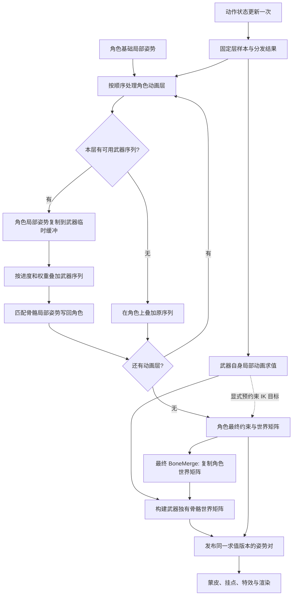

# 第三人称角色与武器动画协作：独立实现规范

本文供 Agent 在其他引擎中独立实现 CS:GO 风格的第三人称角色与武器动画协作，定义数据契约、求值顺序、伪代码、失败策略和验收条件。伪代码中的类型由目标引擎适配，不依赖 Source SDK。

基础矩阵合并、挂点和蒙皮公式参见 [BoneMerge 与 Attachment 跨引擎实现指南](bone_merge_attachment_portable_design.md)。本文补充武器序列参与角色动画求值的反向合并（reverse merge），以及它与最终 BoneMerge 的衔接。

## 1. 目标行为与边界

角色能一边跑动，一边用当前武器的专属姿势开火、换弹；枪跟随最终手部姿势，枪栓、弹匣等部件同时播放武器动画。

| 对象 | 职责 |
|---|---|
| 武器逻辑实例 | 持有开火、换弹、切换等动作状态，推进动作时间 |
| 角色骨架实例 | 求值移动、瞄准、武器动作等动画层，输出角色最终骨架 |
| 武器世界模型骨架实例 | 提供武器专属动画，输出枪与活动部件的最终骨架 |
| 武器动画资产 | 可同时包含角色同名骨骼动画及枪模型独有骨骼动画 |

武器动画资产可以包含与角色兼容的手臂、手部甚至其他身体骨骼。受影响范围由动画轨道、映射、层权重和骨骼遮罩共同决定，不能固定假设为只有双臂。

最低可交付版本包含：兼容骨架、有序动画层、绝对姿势混合、局部姿势反向写回、最终世界矩阵合并、武器独有骨骼动画、时间同步、缓存及生命周期处理。第一人称 viewmodel 使用独立管线，不参与此处反向写回。

## 2. 两种复制的契约

| 操作 | 输入与输出 | 阶段 | 写入规则 |
|---|---|---|---|
| CopyFromCharacter | 角色局部姿势 → 武器临时局部姿势 | 角色动画层求值中 | 只复制允许参与反向驱动的匹配骨骼 |
| CopyToCharacter | 武器临时局部姿势 → 角色局部姿势 | 同一动画层求值中 | 写回相同骨骼；权重已在动画混合时应用 |
| FinalBoneMerge | 角色最终骨骼世界矩阵 → 武器匹配骨骼世界矩阵 | 角色最终姿势发布后 | 严格复制世界矩阵，不播放动画、不回写角色 |

```text
角色当前局部姿势
  → 复制到武器临时姿势
  → 叠加该层对应的武器序列
  → 匹配骨骼写回角色
  → 后续角色层、IK 等最终处理
  → 生成角色世界矩阵
  → 武器同名骨骼复制这些最终矩阵
```

CopyToCharacter 参与角色动画中间结果的计算；FinalBoneMerge 使用包含这些修改及后续处理的最终结果。武器匹配骨骼的最终矩阵只有 FinalBoneMerge 一个写入者，合并后不能再用武器局部动画重建它。

## 3. 数学与资产约束

采用列向量，矩阵从右向左作用。`L[i]` 为骨骼到父骨骼的局部变换，`E` 为实体到世界变换，`W[i]` 为骨骼到世界变换：

```text
角色根骨骼：     Wc[i] = Ec * Lc[i]
角色子骨骼：     Wc[i] = Wc[parent(i)] * Lc[i]
武器匹配骨骼：   Ww[i] = Wc[map(i)]
武器独有根骨骼： Ww[i] = Ew * Lw[i]
武器独有子骨骼： Ww[i] = Ww[parent(i)] * Lw[i]
```

最低版本只支持刚体局部变换，运行时缩放固定为 1。导入时统一单位、坐标轴、四元数及缩放约定。扩展缩放时必须同时扩展姿势类型、混合规则和矩阵契约。

直接复制局部位置和四元数需要以下条件，骨骼同名本身不够：

- 反向驱动骨骼具有兼容的父空间、骨轴、局部绑定姿态及长度约定。
- 非根反向驱动骨骼的父骨骼有兼容映射，不能跨过不同的中间骨链直接复制局部值。
- 根骨骼参与反向驱动时，两模型根空间必须一致。最低版本禁止武器驱动角色实体 root motion，由角色运动系统独占其提取与应用。
- 所有被采样器读取的临时骨骼先初始化，不能只写匹配骨骼后读取未初始化数据。
- 绑定前拒绝重复名称、非法父索引、循环骨架、非有限值和重复目标映射。

局部空间不兼容时，默认禁用反向驱动、回退角色原动画并报告具体骨骼。需要跨体型或跨骨轴适配的项目应另行实现重定向器。最终世界矩阵映射可以比反向映射更宽，但需确认资产蒙皮和骨链适合严格约束。

## 4. 数据模型

以下数学类型、数组、位集合和句柄由目标引擎提供。骨骼数组长度与对应骨架一致；`INVALID = -1`，序列索引 0 可以有效。

```cpp
struct LocalTransform { Vec3 translation; Quat rotation; };
using LocalPose = Array<LocalTransform>;

struct SkeletonAsset {
    AssetId id;
    uint64 revision;
    Array<BoneDef> bones;           // name、parent、bindLocal
    Array<int> parentFirstOrder;
    NameMap boneByName;
};

enum class BlendMode { Absolute, Additive };
struct ClipAsset {
    ClipId id;
    StableName dispatchName;        // 动作语义名，如 reload_rifle
    float durationSeconds;
    BlendMode mode;
    LocalPose additiveReference;    // Additive 模式必需
    BitSet animatedBones;
    Array<EventDef> events;
};

struct LayerSample {
    LayerId id;
    int order;
    ClipId characterClip;
    double unwrappedCycle;         // 连续进度，跨循环事件检测使用
    float cycle;                   // 循环 [0,1)，非循环 [0,1]
    float weight;                  // [0,1]
    BoneMaskId characterMask;      // 每骨骼权重 [0,1]
    bool allowWeaponDispatch;
    ActionInstanceId action;       // 区分两次播放相同动作
};

struct BonePair { int weaponBone; int characterBone; };
struct CooperationBinding {
    EntityHandle character;        // 句柄必须包含 generation
    EntityHandle weapon;
    Array<BonePair> finalPairs;    // 世界矩阵合并
    Array<BonePair> reversePairs;  // 局部写回，必须是 finalPairs 子集
    Array<int> characterForWeapon; // 无最终映射处为 INVALID
    BitSet requiredCharacterBones;
    BitSet requiredWeaponBones;
    uint64 revision;
};

struct ResolvedLayer {
    LayerSample sample;
    ClipId weaponClip;             // 未分发时为 INVALID
    Array<float> weaponWeights;    // 已合成层权重、骨骼遮罩
};

struct EvaluationKey {
    TimeDomain domain;             // 服务器、客户端插值、预测等
    uint64 evaluationId;           // 同帧多次独立求值也不同
    double sampleTime;
    uint64 stateRevision;
    uint64 bindingRevision;
    uint64 characterAssetRevision;
    uint64 weaponAssetRevision;
};

struct PoseSnapshot {
    EvaluationKey key;
    LocalPose local;
    Array<Mat4> world;
    BitSet validWorldBones;
};
```

动画库另需提供稳定名称表及版本。分发缓存键包含两边动画库 ID/revision、源 ClipId 及分发策略 revision；骨架 revision 不能代替动画库 revision。最终姿势缓存还需覆盖实体变换、姿态参数、IK 目标等输入版本，可统一纳入 stateRevision。

## 5. 绑定、分发与时间控制

绑定构建步骤：

1. 按规范化后的完整骨骼名称创建一对一 finalPairs；别名属于显式绑定策略。
2. 从中筛选允许反向驱动且局部空间兼容的 reversePairs。
3. 对动画采样、反向驱动、最终合并、IK、渲染和挂点需求计算骨骼集合及祖先闭包。
4. 将结果保存在实例绑定中，共享资产保持不可变。
5. 校验后原子发布；失败时不得继续使用旧武器索引。

角色动作层用序列语义名查找当前武器的对应序列，也可改用稳定语义 ID。不能将角色序列数字索引直接用于武器库。

```text
角色 reload_rifle → 武器存在 reload_rifle → 武器序列参与反向驱动
角色 move_run     → 武器无 move_run       → 在角色上求值原序列
```

每层只选一条角色姿势路径：角色原序列，或武器分发序列写回。缺失序列、绑定不兼容、武器不可用时回退角色原序列。缓存未找到结果，并在序列或资产版本变化时刷新。

动作状态只推进一次，生成不可变 LayerSample；两个姿势管线消费同一份样本。最低版本共享规范化 cycle，两个序列时长不同时仍在相同 cycle 采样；需要保持武器原速度时，由动作控制器确定持续时间并同时驱动两者。

反向驱动骨骼的有效权重：

```text
weight(w) = layer.weight * characterMask(map(w)) * weaponClipBoneMask(w)
```

无动画轨道的骨骼权重为 0。武器独有骨骼无法查询角色遮罩，需配置明确策略；最低版本使用 `layer.weight * weaponClipBoneMask(w)`。层按 `(order, LayerId)` 稳定排序，每层输入为上一层输出。不能先做完所有角色层，再集中处理武器层。

姿态参数按语义映射，校验范围和单位，必要时归一化后转换；不能直接复制同名但单位不同的参数。

## 6. 混合语义

绝对姿势逐骨骼混合：

```text
t_out = lerp(t_in, t_sample, weight)
q_out = normalize(slerp_shortest_arc(q_in, q_sample, weight))
```

权重 0 保留输入，权重 1 得到采样姿势。CopyToCharacter 直接赋值，不再应用权重。

Additive 扩展必须声明参考姿势。本规范采用局部旋转后乘：

```text
delta_t = t_sample - t_reference
delta_q = inverse(q_reference) * q_sample
t_out   = t_in + weight * delta_t
q_out   = normalize(q_in * slerp_shortest_arc(identity, delta_q, weight))
```

导入和运行时遵守相同 delta 空间与乘法顺序。最低版本未支持 additive 时在资产导入阶段明确拒绝。

## 7. 单次求值伪代码

所有姿势缓冲均为本次求值私有，发布前消费者不能读取。采样是纯计算，不触发动作事件。

### 7.1 角色局部姿势协作

```cpp
LocalPose EvaluateCharacterLocal(const Inputs& in,
                                 Span<ResolvedLayer> layers) {
    LocalPose character = EvaluateCharacterBase(in); // 包含基础过渡
    for (const ResolvedLayer& layer : layers) {       // 稳定排序
        if (layer.sample.weight <= 0) continue;
        if (layer.weaponClip == INVALID) {
            ApplyCharacterClip(character, layer.sample, in);
            continue;
        }

        // 每个分发层重新初始化，避免重复叠加上层临时结果。
        LocalPose scratch = MakeBindPose(in.weaponSkeleton);
        for (BonePair pair : in.binding.reversePairs)
            scratch[pair.weaponBone] = character[pair.characterBone];

        ApplyClip(scratch, layer.weaponClip, layer.sample.cycle,
                  in.weaponPoseParams, layer.weaponWeights);

        for (BonePair pair : in.binding.reversePairs)
            character[pair.characterBone] = scratch[pair.weaponBone];

        // 可选：将序列 IK 依赖按有效骨骼映射收集给角色 IK。
        // 此处不得触发武器最终世界骨架求值。
        CollectDispatchedIKDependencies(layer, in);
    }
    return character;
}
```

ApplyClip 只写存在轨道且有效权重大于 0 的骨骼，遵守序列的混合模式。反向映射之外的临时骨骼仅供本层采样和显式 IK 输入使用，不能将这份临时缓冲直接发布为武器渲染姿势。

### 7.2 武器自身局部姿势

武器独有骨骼需要单独求值，不能因角色已完成反向写回就省略。推荐最低版本采用明确的分层重放：

```cpp
LocalPose EvaluateWeaponLocal(const Inputs& in,
                              Span<ResolvedLayer> layers) {
    LocalPose weapon = EvaluateWeaponBase(in);
    for (const ResolvedLayer& layer : layers) {
        if (layer.weaponClip == INVALID || layer.sample.weight <= 0)
            continue;
        ApplyClip(weapon, layer.weaponClip, layer.sample.cycle,
                  in.weaponPoseParams, layer.weaponWeights);
    }
    return weapon;
}
```

EvaluateWeaponBase 必须排除稍后会重放的分发动作，防止同一动作应用两次。若引擎让武器主序列直接播放当前换弹动作，应改用明确的主序列方案，并从重放列表移除同一动作；两种方案只能选一种。

相同序列可能为角色临时缓冲和武器自身缓冲各采样一次，这不会推进两次时间，也不能触发两次事件。

### 7.3 最终世界矩阵

```cpp
PairSnapshots EvaluatePair(const Inputs& in) {
    ValidateBindingAndInputs(in);
    Array<ResolvedLayer> layers = ResolveAndSortLayers(in);
    LocalPose character = EvaluateCharacterLocal(in, layers);
    LocalPose weapon = EvaluateWeaponLocal(in, layers);

    // 从局部数据准备预约束 IK 目标；不查询未发布武器最终骨架。
    FinalizeCharacterConstraints(character, weapon, in);
    Array<Mat4> characterWorld = ForwardKinematics(
        in.characterSkeleton, character, in.characterEntityWorld);

    Array<Mat4> weaponWorld(in.weaponSkeleton.bones.size());
    for (int w : in.weaponSkeleton.parentFirstOrder) {
        if (!in.binding.requiredWeaponBones.test(w)) continue;
        int c = in.binding.characterForWeapon[w];
        if (c != INVALID) {
            RequireCharacterWorldValid(c);
            weaponWorld[w] = characterWorld[c];
        } else {
            int parent = in.weaponSkeleton.bones[w].parent;
            Mat4 anchor = parent == INVALID
                ? in.weaponEntityWorld : weaponWorld[parent];
            weaponWorld[w] = anchor * ToMatrix(weapon[w]);
        }
    }
    return PublishPair(in.key, character, characterWorld,
                       weapon, weaponWorld);
}
```

requiredWeaponBones 预先包含祖先闭包；所有被合并引用的角色世界矩阵必须有效。发布的武器快照 validWorldBones 仅标记已构建的骨骼，不得将未求值元素视为有效。

最终武器 world 是渲染与挂点的权威结果，其匹配骨骼不一定能由原武器 local 直接 FK 得到。要求 local/world 一致的引擎，须最后从最终 world 反算 local，再禁止后续 Animator 覆盖约束。

## 8. 流程图与调度



“角色 → 武器临时姿势 → 角色”是有限的局部姿势运算，不依赖武器最终世界矩阵，因此不是任务依赖环。可以调度为：

```text
状态样本
  → {角色局部协作，武器局部动画}（私有缓冲，可并行）
  → 角色最终约束与世界矩阵
  → 武器最终合并
  → 挂点与蒙皮
```

左手 IK 应使用预约束目标，例如武器局部 left_hand_attach 相对持枪锚骨的变换，结合角色当前锚骨矩阵生成目标，再解角色手臂，最后合并武器。最低版本要求该目标不依赖正在求解的同一条链；复杂双向约束需要明确的迭代求解器和终止条件，不能递归查询尚未发布的武器最终姿势。

## 9. 写入所有权与消费者

| 数据 | 唯一写入阶段 | 后续消费者 |
|---|---|---|
| cycle、weight、动作实例 | 动作状态更新 | 两个姿势管线、事件系统 |
| 角色局部姿势 | 有序层协作及最终约束 | 角色世界矩阵构建 |
| 武器临时姿势 | 当前分发层 | 该层写回与 IK 依赖 |
| 武器自身局部姿势 | 武器局部动画 | 独有骨骼矩阵、预约束目标 |
| 角色世界矩阵 | 角色最终骨架 | 武器合并、角色蒙皮和挂点 |
| 武器匹配世界矩阵 | FinalBoneMerge | 武器蒙皮和挂点 |
| 武器独有世界矩阵 | 武器最终骨架 | 武器蒙皮和挂点 |

挂点读取最终 world：`attachmentWorld = boneWorld * attachmentLocal`。武器网格使用自己的 inverse bind；模型空间蒙皮矩阵为 `inverse(Ew) * Ww[i] * inverseBindWeapon[i]`。已复制的世界矩阵不能再额外乘一次实体变换。

需要影响握持的后坐力或物理修正，应在角色最终矩阵发布前处理。若要在最终合并后另行修改同名骨骼，须重新定义写入所有权，而非在渲染时追加任意覆盖。

## 10. 事件、网络与重复求值

姿势求值可重入且无副作用。开火音效、抛壳、弹匣实体、弹药扣除等由动作事件系统处理，不在 ApplyClip 或姿势复制时触发。

事件按 `ActionInstanceId + 事件定义 ID + 循环次数` 去重，检测上次与本次 unwrappedCycle 之间跨过的事件。对权重变为 0、动作取消、反播和时间跳转分别定义策略，不能以是否求过骨架判断事件。

弹匣隐藏等持续状态由动作状态重建；回滚后恢复状态并重求姿势。一次性视觉事件与权威游戏逻辑事件分别管理，重采样不能再次扣弹药或生成实体。

网络同步绑定、动作实例、语义序列、cycle 或起始时间、播放速率、权重及必要姿态参数，无需为本机制逐骨骼同步。服务器、客户端插值和预测使用不同 TimeDomain；同域同输入要求确定结果，不同时间域的枪口不要求逐帧相同。

## 11. 缓存、生命周期与 LOD

- 缓存包含所有资产/绑定/输入版本、时间域和采样时刻。evaluationId 区分同帧独立重求；同一求值请求可复用同 key 的已完成结果。
- 切枪原子替换绑定与分发缓存。旧姿势可作为显式过渡快照，但不能用旧索引读取新骨架。
- 骨架、动画库热重载及策略改变时重建映射和需求集合。
- 武器删除或解绑后关闭反向驱动与最终合并，按原角色序列回退。掉落模型可从最后发布世界姿势接管。
- 至少区分 Dirty、Evaluating、Ready；重入同 key 的 Evaluating 报依赖环，不静默读半成品或上一帧姿势。
- 发布不可变快照，任务使用私有缓冲，不修改共享资产 usage flags。
- LOD 保留反向驱动、合并、IK、逻辑挂点的骨骼及祖先。不可见武器仍可能为可见角色贡献姿势。
- 用最终姿势计算或保守扩展 bounds，长枪不能只依靠角色身体包围盒剔除。

## 12. 验收样例

实施后先用合成骨架做无渲染数值测试，再在目标引擎检查真实资产。本次仅编写规范，未运行目标引擎测试。

刚体小坐标样例建议位置误差 `1e-5` 项目单位、旋转误差 `1e-4` 弧度；矩阵比较使用绝对与相对容差，大坐标项目应调整。

| 场景 | 必须满足的预期 |
|---|---|
| 权重 0、0.5、1 | 匹配骨骼局部 x 输入 0，武器绝对采样 x=8，输出依次为 0、4、8 |
| 写回不重复混合 | 权重 0.5 得到 4，不能因写回再混合变成 2 |
| 层顺序 | x=0，先以 0.5 混到 8，再以 0.5 混到 10，结果 7；反序为 6 |
| 临时缓冲 | 重复求值结果相同，不额外累加上一层临时结果 |
| 无分发序列 | 仅在角色上播放，等于关闭分发时的基准 |
| 无轨道或遮罩为 0 | 该角色骨骼保留进入该层时的姿势 |
| 最终跟随 | 所有 finalPairs 满足 Ww[w]≈Wc[c]，包括角色后续瞄准和 IK 的影响 |
| 独有枪栓 | grip 世界位置 (10,0,0)、绕 Z 旋转 90 度，bolt 局部位置 (2,0,0)，最终约为 (10,2,0) |
| 额外实体变换 | 武器实体增加平移后，合并骨骼仍等于角色对应矩阵，无二次位移 |
| 主序列/重放 | 同一动作只应用一次，无双倍 additive 或二次权重衰减 |
| 骨架不兼容 | 报告父空间冲突并禁用反向驱动，不写错误局部值 |
| 序列索引不同 | 按语义正确分发，不共享数字索引 |
| 时间与事件 | 两模型使用相同 cycle；重求不推进时间，不重复产生权威副作用 |
| 生命周期 | 切枪、销毁、热重载及空映射后不访问旧索引 |
| 同帧重求与回滚 | 不同输入版本正确重求，无未来或陈旧缓存 |
| 依赖环 | 拒绝角色 IK 查询未发布的武器最终骨架，或改用预约束目标 |
| 部分骨骼/LOD | 请求骨骼、祖先、独有子骨骼及挂点均有效 |
| 多线程 | 消费者只读到完整且同 key 的姿势对 |

调试信息至少包含动作实例、分发前后序列、cycle、weight、层序、两类骨骼映射及 EvaluationKey。绘制骨骼轴、独有机械骨骼、挂点和 bounds，并用不同颜色标出反向写回与最终合并。

## 13. Agent 实施顺序与完成定义

1. 明确数学约定、姿势类型、动画图插入点、层混合规则及动作时间来源。
2. 实现资产、映射、兼容校验和失败回退。
3. 实现临时复制、绝对混合、写回及有序层求值，通过权重与层序测试。
4. 实现武器自身局部动画，选定主序列或重放方案，验证独有骨骼。
5. 实现角色最终 FK、武器矩阵合并、蒙皮与挂点，验证无二次变换。
6. 接入真实动作、过渡、姿态参数、IK 及事件所有权。
7. 接入版本化缓存、生命周期、网络时间域、线程与 LOD。
8. 在目标引擎用真实角色和至少两把不同动画的武器检查移动中开火、换弹、切枪、瞄准、遮挡及远距离 LOD。

完成时交付代码、合成测试结果、目标引擎验证记录、已支持模式和限制。尚未实现的 additive、跨骨架重定向或复杂双向 IK 必须明确列为不支持，不能仅凭复制函数或流程图宣称整套机制完成。

## 14. 本仓库源码依据与移植差异

链接行号可能漂移，查找时优先使用符号名。

| 位置 | 已确认行为 |
|---|---|
| [C_CSPlayer::AccumulateLayers](../src/game/client/cstrike15/c_cs_player.cpp#L6320) | 新动画状态路径调用武器协作求值 |
| [UpdateDispatchLayer](../src/game/client/c_baseanimatingoverlay.cpp#L598) | 按角色序列名查武器序列 |
| [AccumulateInterleavedDispatchedLayers](../src/game/client/c_baseanimatingoverlay.cpp#L629) | 临时姿势、复制、按层混合、写回、IK 映射及回退 |
| [CopyFromFollow / CopyToFollow](../src/game/shared/bone_merge_cache.cpp#L320) | 局部位置/四元数复制，写回本身不混合 |
| [MergeMatchingBones](../src/game/shared/bone_merge_cache.cpp#L173) | 确保被跟随实体骨架已求值，再复制世界矩阵 |
| [BuildTransformations](../src/game/client/c_baseanimating.cpp#L1665) | 最终构建时执行 BoneMerge，跳过已合并骨骼 |
| [SetUpWeaponAction](../src/game/shared/cstrike15/csgo_playeranimstate.cpp#L1215) | 同步武器动作序列、cycle、速率并处理服务端动画事件 |
| [ValidateParent](../src/game/shared/basecombatweapon_shared.cpp#L219) | 持枪世界模型跟随玩家并启用 BoneMerge |
| [服务端动画协作](../src/game/server/BaseAnimatingOverlay.cpp) | 服务端也有分发和局部写回路径 |

本规范定义独立实现契约，不保证与 Source 所有动画格式、混合和 IK 细节逐帧等价。需要保留以下区别：

- Source 使用保留序列索引判断及模型序列数启发式；移植使用显式 INVALID 和能力声明。
- Source 复制缓存记录 framecount，且构建映射会修改模型 usage flags；本规范使用完整求值键和实例需求集合。
- 本仓库存在 RegenerateDispatchedLayers，但客户端普通 AccumulateLayers 中该调用被注释。不能因为函数存在就假设它自动为独有骨骼重放动画层；独立实现必须落实第 7.2 节的策略。
- Source 的 SetUpWeaponAction 同步武器主序列以满足机械动画和事件需求；本文推荐独立重放，并分离事件系统以避免重复副作用。

配套可编辑流程图：[weapon_character_animation_flow.puml](weapon_character_animation_flow.puml)。
